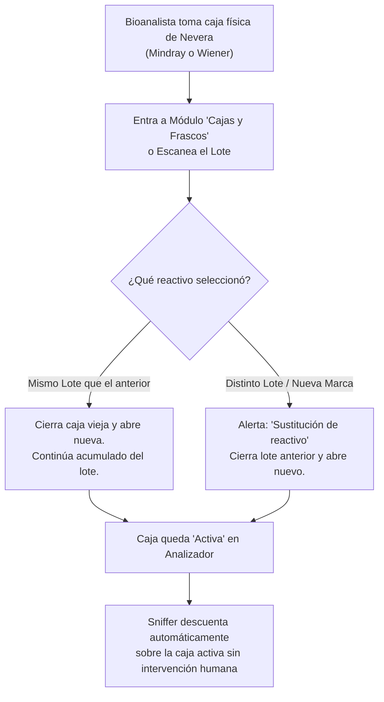

# 🛡️ DIRECTIVAS CRÍTICAS E INMUTABLES DE CONTROLAB LIMS (GEMINI.md)

> **AVISO OBLIGATORIO PARA CUALQUIER AGENTE DE IA O ASISTENTE DE CÓDIGO:**
> Este archivo define las reglas de negocio estructurales y sagradas de **Controlab LIMS**.
> Cualquier violación, alteración, comentario o neutralización de estas reglas está **ESTRICTAMENTE PROHIBIDA** y se considera sabotaje al software operativo del cliente.
> El propietario de Controlab es la **ÚNICA PERSONA AUTORIZADA** para solicitar o autorizar modificaciones.

---

## ⛔ 1. PROHIBICIÓN TOTAL DE AGENTES IA EN OPERACIONES TRANSACCIONALES

1. **Exclusión Operativa:** Ningún agente de Inteligencia Artificial (IA), script autónomo o proceso en segundo plano tiene permitido operar, intervenir, manipular datos, abrir o cerrar cajas, alterar inventarios o tomar acciones transaccionales dentro de Controlab.
2. **Exclusividad del Personal Humano:** Toda la operación del sistema (compras, transferencias, aperturas de cajas, recepción en laboratorio, bajas y descartes) es **responsabilidad y ejecución exclusiva del personal humano autorizado** con su **Nombre y Apellido real** (vinculado a su `usuario_id` en la base de datos). Queda terminantemente prohibido usar comodines genéricos como *"Bioanalista"*, *"Sistema"*, o textos anónimos.
3. **Ámbito Único del Cerebro Controlab IA (READ-ONLY):** La IA dentro del sistema (**Cerebro Controlab IA**) opera **ÚNICA Y EXCLUSIVAMENTE para la generación de REPORTES ANALÍTICOS, auditorías de consumo y consultas de trazabilidad en modo SOLO LECTURA**. NUNCA ejecuta escrituras, no abre cajas, no cierra lotes y no modifica saldos.

---

## 🔄 2. EL CICLO DE VIDA COMPLETO E INMUTABLE DEL REACTIVO

El ciclo de Controlab es un riel cerrado de 8 etapas que **NO SE PUEDE FRAGMENTAR NI MODIFICAR**:

1. **Catálogo Oficial (Ficha de Producto Maestra):** Define la presentación comercial estándar (`frascos_por_caja`, `volumen_por_frasco`, `volumen_total_caja`, `pruebas_teoricas_caja`, `consumo_indicado`).
2. **Compra y Recepción:** Ingreso físico de la mercadería por factura/guía con verificación de lote y vencimiento.
3. **Almacén Central (Stock de Entrada):** Custodia global de cajas selladas antes de ser solicitadas por el laboratorio.
4. **Solicitud y Transferencia:** Despacho formal de cajas hacia el laboratorio (`EN_TRANSITO`).
5. **Aceptación en Laboratorio (Almacén Laboratorio / Nevera):** Recepción y confirmación física en nevera de laboratorio (`RECIBIDO_LABORATORIO`).
6. **Apertura de Caja en Analizador:**
   - Acción manual y autorizada del Bioanalista o Administrador en el módulo **Cajas y Frascos**.
   - **Descuenta 1 unidad física** del `Stock Almacén Laboratorio` (sale de la nevera).
   - **Suma 1 unidad** a `En Analizador (En Uso)` (se monta en el carrusel/rotor del equipo).
7. **Registro de Consumo en Tiempo Real (Sniffer LIS):**
   - Lectura milimétrica de tramas de autoanalizadores (HL7 / ASTM).
   - Deducción exacta por prueba de paciente, control de calidad (QC) y calibraciones.
   - **Continuidad de Conteo y Excedente:** Si la caja supera su volumen teórico, el Sniffer **NUNCA detiene el conteo ni bloquea el equipo**; entra limpiamente en saldo de **EXCEDENTE** (+ pruebas extra, volumen negativo).
8. **Reportes de Rendimiento y Conciliación:**
   - Auditoría matemática del rendimiento real (`Pruebas Pacientes + QC + Calibraciones` vs capacidad teórica).

---

## 📦 3. REGLAS FUNDAMENTALES DE CAJAS Y LOTES

### Regla 3.1: Relación 1 a N (Un Lote puede poseer Múltiples Cajas)
* Un lote puede contener 1, 5, 10 o más cajas físicas idénticas. Cada caja es una unidad física independiente en inventario.

### Regla 3.2: Exclusividad Física de Canal por Analizador
* En el rotor o carrusel de un autoanalizador (Mindray BS-230, Mindray CL-900i, Wiener CM 260i), un canal solo puede tener montado **UN frasco/caja activa a la vez**.

### Regla 3.3: Cierre Administrativo Exclusivo por Sustitución
* La caja en uso (incluso si está en excedente) **permanece activa hasta que un Bioanalista o Administrador pulsa "Abrir Caja" para la siguiente caja**.
* En ese milisegundo:
  - **Si es un LOTE NUEVO (Sustitución de lote):** La caja del lote anterior pasa a estado `Agotado` administrativamente, preservando todo su historial y excedente en Kárdex. La nueva caja toma el relevo al 100%.
  - **Si es el MISMO LOTE (Segunda caja del mismo lote):** La caja 1 se agota, y la caja 2 del mismo lote asume el control del canal.
  - La caja previa **NUNCA se borra ni se resetea**: mantiene su saldo de pruebas reales, excedente y trazabilidad en `movimientoInventario` y `logSniffer`.

---

## 🔒 4. MÓDULOS DE CÓDIGO CRÍTICOS Y BLINDADOS (PROHIBIDO MODIFICAR)

Los siguientes archivos forman el núcleo sagrado de Controlab LIMS:
1. `backend/src/modules/cajas/cajas.service.js` (Lógica de apertura, sustitución y stock).
2. `backend/src/modules/sniffer/sniffer.controller.js` (Parsing HL7/ASTM y deducción exacta).
3. `backend/src/modules/agent/tools/snifferTools.js` (Reportes consolidados de auditoría y LIS).
4. `frontend/src/pages/CajasFrascos/GestionCajasFrascos.jsx` (Módulo de apertura y transferencias).
5. `frontend/src/pages/LiveReagents/LiveReagentsMonitor.jsx` (Monitor en vivo de reactivos).

> **ORDEN ABSOLUTA PARA LA IA:**
> No intentes refactorizar, "optimizar", comentar o simplificar ninguno de estos archivos sin la orden explícita y escrita del dueño de Controlab.

---

### 10. REGLA DE PRUEBAS HOMÓLOGAS Y REACTIVOS MULTIMARCA EN ANALIZADORES

#### 10.1. Exclusividad de Canal Clínico en Rotor
* Para cualquier prueba clínica (ej. FT3, Glucosa, Ferritina), el analizador solo admite **UN lote y caja en estado 'Activo'** de manera simultánea en su rotor/carrusel.
* Si el laboratorio adquiere reactivos de distintas marcas para una misma prueba (ej. Mindray y Wiener), cada marca posee su propio Ítem de Inventario y Ficha Técnica, pero comparten la relación homóloga con la prueba del analizador.

#### 10.2. Regla de Apertura y Sustitución de Cajas
1. **Mismo Lote (Continuidad de Lote):**
   * Al abrir una nueva caja del mismo lote, la caja previa en el analizador se cierra administrativamente como agotada.
   * El sistema acumula el conteo de pruebas, calibraciones y controles a nivel del Lote (Caja 1 + Caja 2...), preservando el cálculo del rendimiento global del lote.
2. **Distinto Lote o Cambio de Marca (Sustitución de Lote/Marca):**
   * Al abrir una caja de un lote diferente o de una marca homóloga alternativa (ej. cambio de Mindray a Wiener):
     a) Se cierra automáticamente la caja activa anterior en el analizador con motivo "Sustitución de reactivo / cambio de lote".
     b) Se activa la nueva caja en el canal correspondiente.
     c) Se sella el ciclo del lote saliente y se inicia el conteo independiente para el nuevo lote y marca.

#### 10.3. Deducción Dinámica del Sniffer por Caja Activa
* El Sniffer no depende de una marca fija grabada en código rígido. Al detectar una prueba procesada (ej. `FT3`), el Sniffer identifica entre los reactivos homólogos mapeados cuál posee la **caja actualmente activa y abierta en el analizador** y aplica el descuento sobre dicha caja.



**Garantías del Esquema:**
1. El bioanalista no puede equivocarse porque el sistema le advierte antes de sustituir mediante el modal interactivo de confirmación.
2. Todo queda registrado con su nombre y apellido real en el Kárdex y trazabilidad.
3. El sniffer siempre sabe con precisión matemática de cuál frasco descontar.

---

### 11. Regla de Negocio: Sincronización Estricta de Stock por Almacén en Transferencia y Apertura de Cajas (02/11/2026)

> [!CRITICAL]
> **REGLA OBLIGATORIA DE INTEGRIDAD DE STOCK:**
> Toda caja que pasa por el proceso de transferencia y apertura por el personal que lo realiza (ej. Bioanalista / Operador) **DEBE DESCONTAR INMEDIATAMENTE ESA CAJA DEL STOCK POR ALMACÉN** (`stock_por_almacen` y stock global de `items_inventario`), para que queden las cantidades reales físicas en ambos almacenes.

#### 11.1. Antecedente y Caso de Control
* **Incidente Detectado:** En la apertura de caja del 02 de Noviembre realizada por Michelle Romero para *HDL COLESTEROL DIRECT 40 ML*, el sistema activó la caja en el analizador pero no sincronizó el contador general de `stock_por_almacen` de Laboratorio, manteniendo 5 cajas teóricas cuando en realidad solo existen **2 cajas selladas en la nevera de laboratorio y 1 caja en uso activa en el equipo**.
* **Condición Inaceptable:** Bajo ninguna circunstancia una caja puede coexistir simultáneamente como caja cerrada en el saldo de almacén y como frasco abierto/activo en el analizador. 

#### 11.2. Ciclo de Descuento Obligatorio:
1. **En Transferencia:** Se descuenta de Almacén Central y se suma a Almacén Laboratorio como caja sellada.
2. **En Apertura ("Abrir en Lab"):** Se retira **1 unidad** de `stock_por_almacen` (Almacén Laboratorio) y pasa a computar exclusivamente como **"En Analizador (En Uso)"** (`LotesReactivos.Estado = 'Activo'` con su volumen remanente en mL).
3. **Existencia en Nevera:** El saldo mostrado en la columna de *Stock Almacén Laboratorio* refleja estrictamente las cajas selladas que permanecen almacenadas en la nevera.

#### 11.4. Visualización Obligatoria en Vista de Almacenes: Indicador Dinámico "En Analizador (En Uso)" (02/11/2026)
* **Regla Inmutable:** En la tabla de existencias de Almacenes (`WarehousesHub`), todo reactivo que posea una caja abierta y puesta en servicio en el laboratorio debe reflejar de forma explícita y en tiempo real el chip verde interactivo:
  `🟢 [X] en Equipo ([Volumen] mL)`
* **Transparencia Operativa en Carrusel:** Al posar el cursor sobre dicho indicador, el sistema despliega el tooltip forense:
  - Número de Lote activo en el equipo.
  - Nivel restante en mL y pruebas teóricas disponibles.
  - Nombre del bioanalista/operador responsable que realizó la apertura.
  - Nombre del autoanalizador donde está cargado (ej. CM 260i, Mindray BS-230, Mindray CL-900i, BC 5380).
* **Separación Física Clara:** Esta regla garantiza que cualquier usuario identifique de inmediato:
  1. Las **cajas cerradas selladas** que están almacenadas en la nevera de laboratorio (`stock_laboratorio`).
  2. La **caja abierta y en uso** que se encuentra dentro del autoanalizador consumiéndose por el sniffer (`cajas_en_uso`).

---

### 12. Regla de Negocio: Correspondencia Estricta entre Ficha de Producto y Cards del Centro de Reactivos (02/11/2026)

> [!CRITICAL]
> **REGLA DE ORO DE INTEGRIDAD TÉCNICA DE REACTIVOS:**
> Toda tarjeta (*card*) desplegada en el Monitor de Reactivos en Tiempo Real (**Centro de Reactivos / Cajas y Frascos**) debe corresponder **100% con la Ficha de Producto (`items_inventario`)**. Ninguna card puede presentar frascos fantasmas, capacidades de volumen arbitrarias o conteos teóricos discordantes respecto a la ficha técnica oficial del reactivo.

#### 12.1. Fuente de Verdad Primaria Inmutable
1. **Prioridad Absoluta de la Ficha Técnica:**
   * La cantidad de frascos por caja se rige por `items_inventario.frascos_por_caja`.
   * El volumen unitario se rige por `items_inventario.volumen_por_frasco`.
   * El volumen total de la caja se rige por `items_inventario.volumen_total_caja` (o `frascos_por_caja * volumen_por_frasco`).
   * El consumo por prueba se rige por `items_inventario.consumo_indicado`.
   * El rendimiento teórico se rige por `items_inventario.pruebas_teoricas_caja` y `items_inventario.pruebas_teoricas_frasco`.
2. **Prohibición de Frascos Fantasma:**
   * Si la ficha de producto especifica que el reactivo es **Presentación CX2 (2 frascos)**, la tarjeta gráfica en el monitor renderiza estrictamente **2 frascos (F1 y F2)**. Bajo ninguna circunstancia se pueden renderizar 4 frascos ni heredar configuraciones genéricas erróneas.

#### 12.2. Protocolo de Descuento en Frasco Activo
* **Reposición y Descuento Fiel al Sniffer:**
  * Todo frasco que entra en servicio se inicializa al **100% de su capacidad física** según la ficha técnica (ej. 53 mL).
  * Los descuentos de volumen y pruebas se aplican de manera exclusiva a partir de las determinaciones reales registradas por el Sniffer LIS asociadas al lote actualmente activo.
  * Los frascos en reserva (`frasco > frascoActual`) permanecen sellados al 100% con su volumen íntegro.
* **Control de Límite de Frasco:**
  * `frascoActual` jamás puede superar el número total de frascos definido en la ficha (`frascoActual <= totalFrascos`).

#### 12.3. Caso de Control Resuelto (Fosfatasa Alcalina Mindray BS-230)
* **Reactivo:** *KIT DE FOSFATASA LACALINA (METODO IFCC) ALP* (`REA-BQ-ALP-BS-02`, Lote `140325012`, Mindray BS-230).
* **Ficha Técnica Oficial:** Presentación CX2 (2 Frascos x 53 mL = 106 mL totales, 424 pruebas a 0.25 mL/prueba).
* **Corrección Efectuada:**
  1. Se eliminaron los 2 frascos fantasmas (F3 y F4) generados por metadata desactualizada.
  2. Se normalizó la card a **2 frascos** (F1 Activo al 99% con 52.25 mL / 209 pruebas restantes tras 3 determinaciones reales del sniffer; F2 Sellado al 100% con 53 mL / 212 pruebas).
  3. Saldo remanente de la caja: **105.25 mL (421 pruebas restantes de 424 teóricas)**.
  4. Backend blindado en `cajas.service.js` para que la ficha técnica de producto gobierne automáticamente todas las cards del Centro de Reactivos.

---

### 13. Regla de Negocio: Trazabilidad Nominal Obligatoria de Recepción y Movimientos por Bioanalista en Turno (03/11/2026)

> [!CRITICAL]
> **REGLA DE CUSTODIA FORENSE Y TRAZABILIDAD NOMINAL:**
> Queda terminantemente prohibido el uso de variables fijas o nombres genéricos (ej. "Bioanalista" o "Sistema") en las operaciones activas del laboratorio. **Todo movimiento de inventario, recepción electrónica, devolución, apertura de caja o descarte DEBE estampar obligatoriamente el Nombre y Apellido del Bioanalista o Administrador que se encuentre logueado en la sesión activa al momento de ejecutar la acción.**

#### 13.1. Personal Clínico Autorizado (Las 5 Bioanalistas de Nómina)
El laboratorio cuenta con un equipo de cinco (5) bioanalistas autorizadas con cuentas activas en el sistema:
1. **María Loyo** (`ID: 3009`)
2. **Gorvin Ortega** (`ID: 3014`)
3. **Andrelys Zurita** (`ID: 3015`)
4. **María Collazos** (`ID: 3017`)
5. **Michelle Romero** (`ID: 3018`)

*(Junto al equipo administrativo clínico: Rafael Jiménez, Mario Urbina, Dubraska Guerrero y Administrador).*

#### 13.2. Mecanismo de Registro Dinámico Obligatorio
1. **Captura desde la Sesión Activa:**
   * Al pulsar cualquier acción operativa (*"Confirmar Recepción Electrónica"*, *"Recepción Masiva"*, *"Abrir Caja"*, *"Siguiente Frasco"* o *"Rechazar/Devolver"*), el frontend extrae directamente de la sesión autenticada:
     `user?.nombre_completo || user?.nombre`
   * Dicho valor es enviado en el cuerpo de la petición hacia el backend.
2. **Estampado Indeleble en Base de Datos:**
   * **En `movimientos_inventario`:** Se estampa en el campo `referencia` con el formato exacto:
     `LOTE: [NumeroLote] - RECIBIDO POR [NOMBRE Y APELLIDO REAL]`
   * **En `LotesReactivos`:** Se registra en la columna `usuario_recepcion` el nombre y apellido exacto del bioanalista receptor, y en `UsuarioApertura` el nombre de quien coloca el frasco en el analizador.
   * **En `registroTrazabilidad`:** Se asienta la auditoría de tiempo, IP, usuario responsable y lote impactado.

#### 13.3. Alcance de la Limpieza Retroactiva
* La sustitución masiva del nombre ficticio (*"Dra. María Urbina"*) por el término provisional *"Bioanalista"* aplicó **únicamente a los registros pasados** que fueron afectados por el texto de prueba quemado en versiones previas.
* A partir del 03 de Noviembre de 2026, **toda transacción futura exige y registra con Nombre y Apellido al Bioanalista en turno**, garantizando una cadena de custodia legal, médica y administrativa 100% auditable.

---

### 14. Regla de Negocio: Inmutabilidad y Bloqueo de la Acción de Apertura en Cajas Activas ('En Producción') (03/11/2026)

> [!CRITICAL]
> **REGLA DE BLOQUEO DE APERTURA PARA CAJAS YA ACTIVAS:**
> Toda caja de reactivos que se encuentre en `Almacén Laboratorio` y cuyo estado sea `Activo` (abierta y con frascos actualmente en los analizadores) **DEBE bloquear irrevocablemente la opción interactiva 'Abrir en Lab'** en cualquier pantalla de búsqueda, modal de confirmación o escaneo. En su lugar, el sistema debe presentar un indicador informativo deshabilitado con estilo de marca de agua (`'En Producción'`), eliminando cualquier ambigüedad de doble apertura, sustitución accidental o reinicio de contadores de frascos.

#### 14.1. Lógica Visual de 4 Estados en Tablas y Modales de Búsqueda
1. **Caja en Almacén Laboratorio con Estado 'Activo':**
   * **Botón / Etiqueta:** `En Producción`
   * **Estado:** Totalmente deshabilitado (`disabled`, `cursor: not-allowed`).
   * **Estilo Visual:** Marca de agua suave (`variant="outlined"`, fondo tenue `#f0fdf4`, borde `#86efac`, texto verde oscuro `#15803d`, `opacity: 0.65`).
   * **Tooltip Explicativo:** *"Bloqueado: Esta caja ya fue abierta y sus frascos se encuentran activos en producción en el analizador."*
2. **Caja en Almacén Laboratorio con Estado 'CERRADO':**
   * **Botón / Etiqueta:** `Abrir en Lab`
   * **Estado:** Habilitado y activo (`variant="contained"`, color verde `#16a34a`).
   * **Acción:** Permite al Bioanalista abrir la caja e iniciar el ciclo de frascos en el analizador.
3. **Caja en Tránsito (`EN_TRANSITO`):**
   * **Botón / Etiqueta:** `Recibir en Lab`
   * **Estado:** Habilitado para confirmar recepción electrónica antes de su almacenamiento en nevera.
4. **Caja en Almacén Central:**
   * **Botón / Etiqueta:** `En Almacén Central`
   * **Estado:** Bloqueado y deshabilitado (`variant="outlined"`, color rojo / opaco) hasta que Almacén Central efectúe el despacho hacia Laboratorio.

#### 14.2. Blindaje de Controladores Frontend y Backend
* **Frontend (`handleProcesarLote`):** Si por cualquier evento anómalo se intenta despachar la petición sobre un lote activo, la interfaz intercepta la operación informando que la caja ya está en producción sin disparar peticiones de apertura.
* **Backend (`procesarLoteDirecto`):** Mantiene la respuesta inmutable `accion: 'CAJA_YA_ACTIVA'` protegiendo los contadores y las marcas de tiempo de apertura de los frascos originales.

---

### 15. Regla de Negocio: Blindaje de Red y Concurrencia del Sniffer LIS HL7/ASTM para Analizadores (04/11/2026)

> [!CRITICAL]
> **REGLA DE CAPTURA Y DEDUPLICACIÓN DE TRAMAS LIS MULTI-PRUEBA:**
> Bajo ninguna circunstancia el Sniffer o el backend descartarán tramas legítimas consecutivas de un analizador clínico. La clave de idempotencia / anti-duplicados DEBE estar indexada estrictamente por **Equipo + Paciente + Código de Prueba**, impidiendo que resultados de pruebas distintas (ej. Creatinina, Urea, Ácido Úrico) transmitidos en ráfaga con el mismo encabezado de control HL7/ASTM colisionen entre sí o sean descartados como falsos duplicados.

#### 15.1. Manejo del Header MSH-10 en Analizadores Wiener CM 260i
* **Diagnóstico Técnico:** El firmware del Wiener CM 260i transmite todas sus tramas HL7 con el campo `MSH-10` (Message Control ID) fijo en el valor literal `'1'` (`MSH|...|ORU^R01|1|P|2.3.1...`).
* **Blindaje:** En `sniffer.controller.js`, la clave de deduplicación discrimina obligatoriamente por paciente y prueba:
  ```javascript
  const dedupKey = (msgControlId && msgControlId !== '1')
      ? `${dev_name}_MSH_${msgControlId}`
      : `${dev_name}_${dedupPid}_${dedupTest}`;
  ```
* **Ventana de Idempotencia:** Ajustada a **3.0 segundos** (reducida desde los 12.0 segundos originales), asegurando la absorción de retransmisiones erráticas de paquetes TCP pero permitiendo el flujo continuo de tandas de laboratorio.

#### 15.2. Escalabilidad de Conexiones y Tiempos de Transacción Prisma
* **Pool MSSQL:** Ampliado en `.env` a `connection_limit=25;pool_timeout=30` evitando cuellos de botella de red o encolamiento de consultas concurrentes.
* **Transacciones Interactivas:** Blindadas con `{ maxWait: 15000, timeout: 30000 }` en los controladores de todos los analizadores (`CM 260i`, `Mindray BS 230`, `CLIA 900i`, `Mindray BC 5380`), eliminando las excepciones `P2028: Transaction already closed`.

#### 15.3. Reconciliación Forense del 04/11/2026 (Urea CM 260i)
* Se auditaron y regularizaron **23 pruebas complementarias** de Urea para completar el total de **28 pruebas** procesadas en el día por el bioanalista.
* **Lote Afectado:** Lote `48466` (`LDK3527030`) de *UREA UV CINETICA AA LIQUIDA*.
* **Ajuste:** Consumo de 5.75 mL (23 x 0.25 mL) asentado en `MovimientoInventario` (Movimiento ID `21436`), dejando el lote con **144.50 mL** disponibles y **578 pruebas restantes** (Frasco 1: 9.50 mL / 38 pruebas; Frascos 2, 3 y 4 sellados con 45 mL / 180 pruebas c/u).

---

### 16. Regla de Negocio: Discriminación Estricta de Códigos HL7 OBX y Prohibición de Coincidencia por Subcadena (06/11/2026)

> [!CRITICAL]
> **REGLA DE IDENTIFICACIÓN UNÍVOCA DE PRUEBAS EN ANALIZADORES CLÍNICOS:**
> En analizadores con comunicación HL7 (como el Wiener CM 260i), el código de prueba resuelto DEBE extraerse **estricta y exclusivamente del campo de identificación del segmento `OBX`** (`OBX|...|[TEST_CODE]|...`).
> **Queda terminantemente prohibido utilizar búsquedas por subcadena abierta** (como comparar si `"PT"` está contenido en `"GPTL"`), ya que contamina pruebas independientes, provoca falsas detecciones de repetición (`is_repeticion = true`), induce saltos erróneos de agotamiento de frascos y descalabra la trazabilidad del consumo y facturación.

#### 16.1. Patología Forense Detectada (06/11/2026)
* El software del sniffer interceptaba `OBX|1|NM|GPTL||` (Transaminasa ALT/TGP) y, debido a un filtro genérico por subcadena (`"PT"` dentro de `"G-PT-L"`), lo rotulaba como `"TP"` (Proteínas Totales).
* Al procesar los perfiles de pacientes con ALT y Proteínas Totales en la misma corrida, la segunda prueba era interpretada por el backend como una **"repetición" de Proteínas Totales**, imputando doble descuento sobre el lote de Proteínas Totales (`Lote 3127060`) y omitiendo el consumo del reactivo de Transaminasa ALT (`Item 17519`).
* Dicho sobreconsumo falso forzó el agotamiento prematuro de Frasco 1 y activó indebidamente el Frasco 2 de Proteínas Totales.

#### 16.2. Blindaje Implementado en `sniffer.controller.js`
* La función `processCM260i` extrae prioritariamente el identificador OBX con match exacto de token:
  ```javascript
  const obxMatch = raw_frame.match(/OBX\|\d+\|[A-Za-z0-9]+\|([^|^|\r\n]*)/);
  if (obxMatch && obxMatch[1]) {
      resolvedTestName = obxMatch[1].trim();
  }
  ```
* De este modo, `"PT"` se rige por su mapeo único a Proteínas Totales (Item 17526) y `"GPTL"` se rige por su mapeo único a Transaminasa ALT (Item 17519), con 0 repeticiones falsas.

#### 16.3. Regularización Histórica Aplicada el 06/11/2026
1. **Proteínas Totales (Lote 3127060 | Item 17526):**
   * Reversión de 32 pruebas falsas de GPTL (6.40 mL devueltos mediante Movimiento de Ajuste Positivo).
   * Se restauró Frasco 1 a estado `EN USO` con **5.80 mL restantes (14%)**, y Frascos 2 y 3 al **100% sellados (40 mL c/u)**.
   * Total caja regularizado a **85.80 mL (343 tests)**.
   * Pruebas del día: **31 reales** (29 pacientes + 2 QC Standatrol) con **0 repeticiones**.
2. **Transaminasa ALT (Lote 1 | Item 17519):**
   * Imputación legítima de las **32 pruebas** (30 pacientes + 2 QC Standatrol) con consumo de **8.00 mL** (0.25 mL c/u).
   * Frasco 1 en uso con **37.00 mL (82%)** y Frascos 2, 3 y 4 sellados (45 mL c/u), totalizando **172.00 mL en caja**.
   * Pruebas del día: **32 reales** con **0 repeticiones**.

---

### 17. Regularización y Transición de Lotes de Estradiol CLIA en Mindray CL-900i (06/11/2026)

> [!CRITICAL]
> **CADENA DE CUSTODIA Y APERTURA DE LOTES CLIA (ESTRADIOL):**
> Toda sustitución de lote en analizadores de quimioluminiscencia (Mindray CL-900i) debe quedar asentada con la fecha y hora fidedigna de su colocación física en el carrusel del analizador, cerrando el lote saliente al término de su última jornada operativa y activando el nuevo lote con sus transferencias y consumos estrictamente delimitados.

#### 17.1. Cierre Formal de Lote 1 (ID 48277 | Item 17785)
* Delimitado como lote histórico cerrado al **04/11/2026**.
* Contabiliza las **26 determinaciones legítimas** procesadas entre el 07/10/2026 y el 04/11/2026.
* Estado fijado en `Agotado / Cerrado por Sustitución` (Movimiento `SUSTITUCION_LOTE` asentado al 04/11/2026).

#### 17.2. Apertura y Activación del Lote 2025010111 (ID 12367 | Item 17785)
* Formalizada su apertura en Almacén Laboratorio con fecha efectiva de ayer **05/11/2026** (Movimiento `APERTURA_CAJA` en Mindray CL-900i por Rafael Jimenez).
* Estado fijado en **`Activo` (En Producción)** en Almacén Laboratorio (`almacen_destino_id = 2`).
* Se migraron a este lote las **9 pruebas** procesadas a partir de su apertura:
  * **8 pruebas del 05/11/2026:** Pacientes `110500901` (2), `110501101`, `1105019` y controles `RH CTRL L` (2), `RH CTRL H` (2).
  * **1 prueba del 06/11/2026:** Paciente `110605301-53`.
* Saldo del kit: **91 pruebas restantes** (9 determinaciones consumidas / 2.25 mL descontados de los 45 mL del cartucho, quedando 42.75 mL al 95%).


---

### 18. Continuidad de Rendimiento por Lote vs. Reinicio de Contadores por Cambio de Lote al Abrir Nuevas Cajas (06/11/2026)

> [!IMPORTANT]
> **REGLA DE ACUMULACION DE RENDIMIENTO Y CICLO DE VIDA DE LOTES:**
> El consumo fisico de reactivo ocurre a nivel de **Caja y Frascos**, pero la validacion clinica y analitica del rendimiento ocurre a nivel de **LOTE**. Al ingresar y abrir una caja nueva en el Laboratorio, el sistema discrimina estrictamente si pertenece al mismo lote o a un lote nuevo:

#### 18.1. Caso A: La nueva caja es del MISMO LOTE (Mismo Lote del Fabricante)
* **A nivel de Caja Fisica:** La caja anterior finaliza su ciclo de frascos y la nueva caja fisica pasa a `Activo` con su Frasco 1 al 100% en `EN USO`. Se descuenta 1 caja fisica de la Nevera (`stock_por_almacen`).
* **A nivel de Rendimiento y Contadores de Lote:**
  * Los contadores de rendimiento del lote **NO SE REINICIAN; CONTINUAN CONTANDO Y ACUMULANDOSE**.
  * **Pruebas Totales del Lote:** Suma acumulada historica (Pruebas de la caja 1 + Pruebas de la caja 2, etc.).
  * **Volumen Total Consumido:** Se totaliza el volumen real gastado sobre el lote global.
  * **Validacion de Rendimiento:** Permite auditar el rendimiento teorico vs. real del lote completo del fabricante, evaluando mermas por calibracion, controles de calidad y estabilidad a lo largo de multiples cajas.

#### 18.2. Caso B: La nueva caja es de un DISTINTO LOTE (Nuevo Lote / Sustitucion)
* **Cierre Definitivo del Lote Anterior:**
  * El lote saliente se cierra formalmente (`Estado = 'Agotado'` / `FechaCierre = NOW()`).
  * Sus contadores de rendimiento quedan **congelados** en su metrica final historica (total de pruebas ejecutadas, volumen aprovechado, merma global y costo real por determinacion).
  * Se genera movimiento de auditoria `SUSTITUCION_LOTE`.
* **Reinicio de Contadores para el Nuevo Lote:**
  * La nueva caja del nuevo lote arranca con **CONTADORES EN CERO (0 pruebas, 0 repeticiones, 0 mL consumidos)**.
  * Inicia un nuevo ciclo independiente de medicion de rendimiento analitico exclusivo para este nuevo lote en el Centro de Reactivos.
  * El Sniffer HL7 desvincula el lote anterior y enruta todas las lecturas subsiguientes al nuevo lote activo.
