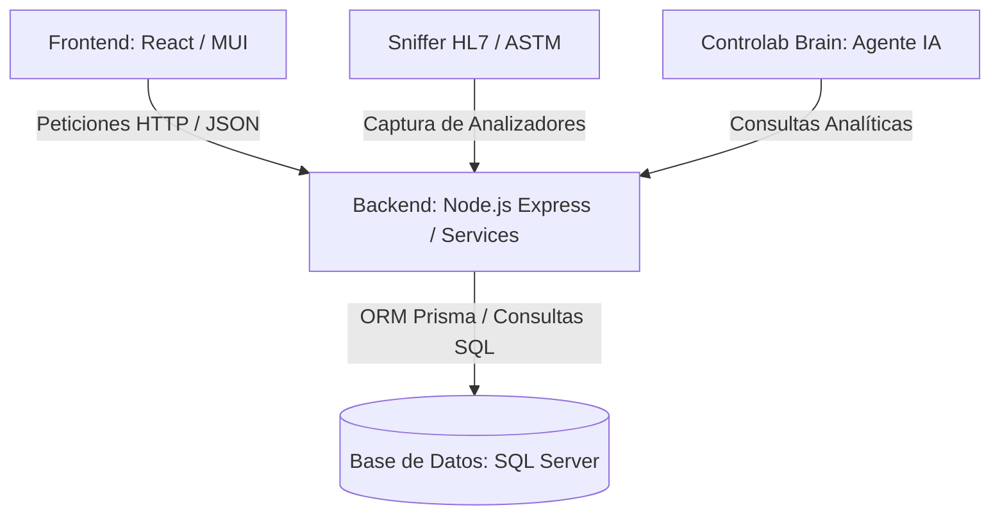

# 📘 MANUAL MAESTRO DE REGLAS DE NEGOCIO — LIMS CONTROLAB IA

> **Estatus:** OFICIAL E INMUTABLE  
> **Ámbito de Aplicación:** Frontend (React), Backend (Node.js/Express), Base de Datos (SQL Server/Prisma) y Agente IA (Controlab Brain).  
> **Fecha de Actualización:** 21 de Octubre de 2026  

---

## 🎯 1. ¿Por qué se rompen las reglas de negocio a veces? (Diagnóstico de Arquitectura)

Las fallas en las reglas de negocio **no se deben a un cambio intencional de la lógica**, sino a fricciones de integración entre las 4 capas del sistema:

### Principales causas técnicas identificadas:
1. **Desfase de Nomenclatura entre Prisma y el Backend:**
   * *Ejemplo real:* En SQL Server la columna es `almacen_destino_id`. Si en el backend se escribe `AlmacenId`, Prisma falla inmediatamente por tipado estricto (`Unknown argument`).
2. **Falsos positivos en el reconocimiento de lenguaje del Cerebro:**
   * *Ejemplo real:* La búsqueda de subcadenas como `'ca'` (pensada para Calcio) rompía cualquier pregunta que contuviera la palabra común `"cada reactivo"`.
3. **Falta de enlace directo con el servicio maestro:**
   * Cuando un módulo de reportes realizaba su propia consulta SQL aislada en lugar de reutilizar el método oficial `cajasService.getCajasLaboratorio()`, provocaba que seleccionara una caja vacía en lugar de la caja activa que va por el 3er frasco.
4. **Desconexión entre Rutas y Menú (RBAC):**
   * Ocultar una opción en el menú visual pero no proteger la ruta en `App.js` permitía accesos indebidos si se conocía la URL.

---

## 🏢 2. Reglas de Almacenes, Transferencias y Recepciones

### Regla 2.1: Cadena Obligatoria de Suministro
* Toda mercancía ingresa **exclusivamente por Almacén Central (ID 1)** vía el módulo de Recepción.
* Ningún reactivo pasa al laboratorio de forma directa sin una orden formal de despacho.

### Regla 2.2: Prohibición Estricta de Apertura en Central (REGLA INQUEBRANTABLE)
* **Ningún usuario Bioanalista puede abrir ni activar cajas que se encuentren en Almacén Central (`almacen_origen_id = 1`) ni en estado `EN_TRANSITO`.**
* El botón de apertura queda bloqueado físicamente en la interfaz si la caja no está en Almacén Laboratorio.
* Si por backend se intenta activar una caja sin transferencia, el servicio arroja la excepción:
  > *"Acción bloqueada: Esta caja se encuentra en el ALMACÉN CENTRAL. Es obligatorio realizar la transferencia y confirmación de recepción en el Almacén de Laboratorio antes de que un Bioanalista pueda abrirla."*

### Regla 2.3: Procedimiento Obligatorio de Transferencia
1. **Despacho desde Almacén Central:** Se crea la orden con `estado_transferencia = 'EN_TRANSITO'`.
2. **Recepción en Laboratorio:** La Bioanalista verifica físicamente y hace clic en **Confirmar Recepción**.
3. **Estatus Válido:** La caja pasa a `estado_transferencia = 'RECIBIDO_LABORATORIO'` y `almacen_destino_id = 2`.
4. **Apertura:** Solo en este momento se habilita el botón verde **`Abrir Caja / Activar`**.

### Regla 2.4: Registro Formal en Kárdex
Toda operación genera un movimiento inmutable en `movimientos_inventario`:
* `TRANSFERENCIA_DESPACHO`
* `RECEPCION_LABORATORIO`
* `APERTURA_CAJA`
* `SUSTITUCION_LOTE`

---

## 📦 3. Reglas de Cajas, Frascos y Monitoreo en Vivo

### Regla 3.1: Unicidad de Caja Activa en Carrusel
* En cada autoanalizador (**CM 260i, Mindray BS-230, Mindray CL-900i, Mindray BC 5380**) solo puede existir **1 caja en estado `Activo`** por determinación/reactivo.
* Si el bioanalista abre una nueva caja del mismo producto:
  * La caja anterior se cierra automáticamente con estatus `Agotado` o `Cerrado por Sustitución`.
  * Se registra en el kárdex el motivo: `CIERRE POR SUSTITUCION: APERTURA DE NUEVO LOTE...`.

### Regla 3.2: Continuidad de Rendimiento del Mismo Lote
* Si la nueva caja abierta pertenece al **mismo número de lote** que una caja previa, el sistema mantiene el identificador del lote y acumula el rendimiento global sin reiniciar a cero las métricas históricas de calibración.

### Regla 3.3: Desglose Secuencial de Frascos
* Cada caja contiene `total_frascos` con un volumen individual de `vol_por_frasco` mL.
* **Ciclo de vida del frasco:**
  1. `Frasco 1`: Pasa a **`EN USO`** en el analizador al momento de la apertura de caja.
  2. `Frascos 2..N`: Permanecen en estado **`SELLADO`** en la nevera de respaldo.
  3. Al agotarse el volumen del frasco actual, el sistema avanza al siguiente (`F2`, `F3`...), marcando los previos como **`AGOTADO`**.

### Regla 3.4: Regla de Alerta Crítica para Compra / Reposición
* Un reactivo entra en **NIVEL CRÍTICO (Alerta Roja ≤20%)** **únicamente cuando se encuentra en su ÚLTIMO frasco**.
* Mientras existan frascos sellados de respaldo (F2, F3, etc.), el reactivo **NO** es crítico, garantizando que el personal de compras no emita pedidos de emergencia innecesarios.

---

## 📡 4. Reglas del Sniffer de Red y Auditoría HL7 / ASTM

### Regla 4.1: Descuento Automático en Tiempo Real
* El sniffer captura las órdenes de salida de los equipos y mapea la prueba contra el reactivo mediante `mapeo_pruebas_reactivos`.
* Por cada determinación procesada, se descuenta la dosis oficial (`consumo_indicado`, ej. `0.25 mL`) de la caja activa correspondiente.

### Regla 4.2: Clasificación de Corridas
Toda prueba capturada se clasifica sin excepción en una de 4 categorías:
1. `PACIENTE` (Pruebas de rutina diagnóstica).
2. `REPETICION` (RPT — Merma técnica por verificación o dilución).
3. `CALIBRACION` (CAL — Calibradores multiparamétricos).
4. `CONTROL_CALIDAD` (QC — Sueros control nivel 1 y nivel 2).

### Regla 4.3: Inmutabilidad de la Historia Diaria (NO SE PUEDE OBVIAR)
* Los reportes del sistema y del Cerebro **nunca deben truncar ni ignorar fechas**.
* Deben presentar la historia cronológica día por día de todas las determinaciones registradas desde la apertura hasta la fecha actual.

---

## 🔐 5. Matriz de Control de Acceso Basada en Roles (RBAC)

| Módulo / Ruta | Administrador (`ADMIN`) | Bioanalista (`BIOANALISTA`) | Motivo de Seguridad |
| :--- | :---: | :---: | :--- |
| **Panel de Control** (`/dashboard`) | ✅ Permitido | ✅ Permitido | Monitoreo general de laboratorio. |
| **Centro de Control Reactivos** (`/live-reagents`) | ✅ Permitido | ✅ Permitido | Monitoreo en carrusel de equipos. |
| **Gestión Cajas y Frascos** (`/cajas-frascos`) | ✅ Permitido | ✅ Permitido | Apertura y cambio de frasco. |
| **Auditoría Red / Sniffer** (`/sniffer`) | ✅ Permitido | ✅ Permitido | Auditoría técnica de tramas. |
| **Reportes y Bitácora** (`/reports`, `/audit-log`) | ✅ Permitido | ✅ Permitido | Trazabilidad de laboratorio. |
| **Controlab Brain** (`/brain-agent`) | ✅ Permitido | ✅ Permitido | Consultas analíticas de reactivos. |
| **Solicitudes de Productos** (`/solicitudes`) | ✅ Permitido | ✅ Permitido | Pedidos de reactivos a Central. |
| **Catálogo Ficha Producto** (`/inventory`) | ✅ Permitido | ❌ **PROHIBIDO** | Configuración maestra de precios/códigos. |
| **Catálogo de Reactivos** (`/reagents`) | ✅ Permitido | ❌ **PROHIBIDO** | Alta de fórmulas y técnicas. |
| **Recepción de Mercancía** (`/reagents/reception`) | ✅ Permitido | ❌ **PROHIBIDO** | Recepción de facturas de proveedores. |
| **Almacén / Depósito Central** (`/warehouses`) | ✅ Permitido | ❌ **PROHIBIDO** | Despacho global y conteo de almacén. |
| **Compras e Inflación** (`/compras`) | ✅ Permitido | ❌ **PROHIBIDO** | Costos comerciales y proveedores. |
| **Estructura de Costos** (`/costos`) | ✅ Permitido | ❌ **PROHIBIDO** | Finanzas y márgenes del laboratorio. |
| **Gestión de Usuarios** (`/users`) | ✅ Permitido | ❌ **PROHIBIDO** | Gestión de contraseñas y roles. |

---

## 🧠 6. Reglas del Asistente Inteligente (Controlab Brain)

1. **Prioridad Absoluta de la Caja en Uso:**
   * Al consultar cualquier reactivo (ej: `Reporte de Creatina`, `Reporte de HDL`), el Cerebro consulta directamente `cajasService.getCajasLaboratorio()` y selecciona la **caja física actualmente en carrusel**, nunca un lote cerrado o inactivo.
2. **Auditoría Completa Día por Día:**
   * El reporte desglosa obligatoriamente:
     * Balance de caja (capacidad teórica, consumido real, restante disponible).
     * Frasco en uso y frascos sellados en reserva.
     * Tabla cronológica diaria sin filtros de truncamiento (muestra cada día de operación).
3. **Sintaxis de Intenciones Precisa:**
   * Quedan prohibidas las coincidencias con palabras cortas de 2 letras (como `'ca'`) que puedan confundirse con palabras del lenguaje natural (`"cada"`, `"caja"`, etc.).

---

## 🛡️ 7. Protocolo de No Regresión para Desarrollo

Para garantizar que **ninguna regla de negocio se vuelva a romper**:
1. **Validación de Esquema Prisma:** Nunca introducir nombres de atributos asumidos (`AlmacenId`); consultar siempre `schema.prisma` (`almacen_destino_id`).
2. **Revisión Doble Frontend/Backend en RBAC:** Toda exclusión de menú en `Sidebar.js` debe estar acompañada de su `ProtectedRoute` en `App.js` y middleware en backend.
3. **Pruebas de Flujo Completo:** Toda modificación debe ser validada en el flujo: *Almacén Central ➡️ Transferencia ➡️ Recepción ➡️ Apertura Bioanalista ➡️ Sniffer ➡️ Cerebro*.

---

## 🛑 8. REGLAS DE NEGOCIO ESTRICTAS E INMUTABLES (ACTUALIZACIÓN OFICIAL — 28 DE OCTUBRE DE 2026)

### 8.1. TRAZABILIDAD HUMANA CON NOMBRE Y APELLIDO OBLIGATORIO
* Todo movimiento, transacción o evento registrado en el sistema (**Apertura de caja**, **Transferencia entre almacenes**, **Recepción en laboratorio**, **Ajuste de inventario**, **Baja o descarte de lote**, y **Consumo**) **DEBE estar asociado formalmente a la persona que realiza la acción con su Nombre y Apellido real** (vinculado a su `usuario_id` en la base de datos).
* **PROHIBICIÓN:** Queda terminantemente prohibido utilizar comodines, textos genéricos o valores por defecto (como *"Bioanalista"*, *"Sistema"*, o textos anónimos) para ocultar o simular la identidad de quien ejecuta una operación.

### 8.2. PROHIBICIÓN ABSOLUTA DE DECISIONES AUTÓNOMAS SOBRE INVENTARIO
* El Agente IA (Antigravity / Cerebro) y cualquier proceso automatizado tienen **TOTALMENTE PROHIBIDO tomar decisiones discrecionales o a libre albedrío** sobre:
  1. **Cajas y Lotes:** Aperturas, cierres, bajas forzadas, transiciones o sustituciones arbitrarias.
  2. **Existencias y Stock:** Modificación de saldos en Almacén Central o Laboratorio sin una solicitud explícita y justificada por el usuario.
  3. **Kárdex y Movimientos:** Creación, edición o eliminación de movimientos sin solicitud directa del usuario por este canal.
* **Toda acción debe apegarse estrictamente a las funciones operativas del sistema** tipificadas en este manual y ejecutarse **ÚNICA Y EXCLUSIVAMENTE bajo instrucción directa y autorizada del usuario**.

### 8.3. ENMARCADO FUNCIONAL ESTRICTO Y NO REGRESIÓN
* Cualquier operación técnica o de soporte debe circunscribirse 100% al marco funcional para el cual fue diseñado Controlab LIMS.
* **Cero Libre Albedrío:** Ningún script, proceso o regla puede inferir o inventar estados físicos que no correspondan a la realidad documentada del laboratorio.
* Todo cambio debe respetar el flujo natural: **Recepción ➔ Apertura manual por personal autorizado ➔ Lectura exacta de tramas por Sniffer ➔ Descuento milimétrico en Kárdex**.

---

## ⛔ 9. PROHIBICIÓN TOTAL DE AGENTES IA EN OPERACIONES DE CONTROLAB — EXCLUSIVIDAD DEL CEREBRO PARA REPORTES

### 9.1. EXCLUSIÓN TOTAL DE AGENTES IA EN LA OPERACIÓN INTERNA
* **Ningún agente de Inteligencia Artificial (IA)**, script autónomo o proceso en segundo plano tiene permitido operar, intervenir, manipular datos, abrir o cerrar cajas, alterar inventarios o tomar acciones transaccionales dentro de Controlab.
* La operación del sistema (compras, transferencias, aperturas de cajas, recepción en laboratorio, bajas y descartes) es **100% responsabilidad y ejecución exclusiva del personal humano autorizado** con su Nombre y Apellido real.

### 9.2. ALCANCE ÚNICO Y EXCLUSIVO DEL CEREBRO CONTROLAB IA: SOLO REPORTES (READ-ONLY)
* La participación de la Inteligencia Artificial en Controlab (**Cerebro Controlab IA**) queda restringida **ÚNICA Y EXCLUSIVAMENTE a la generación de REPORTES ANALÍTICOS, auditorías de consumo y consultas de trazabilidad en modo SOLO LECTURA**.
* El Cerebro **NUNCA** ejecutará escrituras en base de datos, no abrirá cajas, no cerrará lotes, no modificará saldos y no intervendrá en las transacciones operativas del LIMS. Su única función es recopilar, calcular y presentar reportes fidedignos y transparentes al usuario.

### 9.3. INMUTABILIDAD ABSOLUTA DE LAS REGLAS DE NEGOCIO VALIDADAS
* Queda **TERMINANTEMENTE PROHIBIDO** para cualquier programador o modelo de IA modificar, comentar, neutralizar o alterar las reglas de negocio validadas del sistema (tales como la exclusividad de canal en rotor, la sustitución de cajas por canal, el flujo obligatorio Almacén Central ➔ Laboratorio, y la deducción exacta del Sniffer).
* Las reglas de negocio operativas son **PERMANENTES E INMUTABLES**, protegiendo la paz mental del cliente y la integridad clínica del laboratorio sin generar estrés ni retrocesos operativos.
