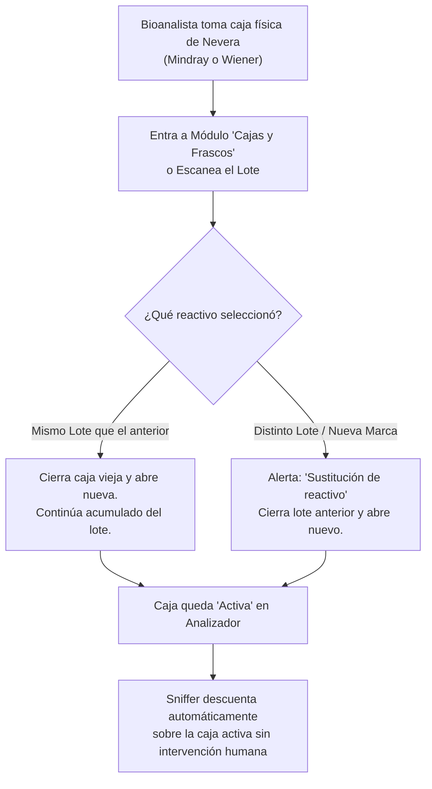

# 📜 REGLAS DE NEGOCIO OFICIALES E INMUTABLES - SISTEMA CONTROLAB

> **Documento Maestro de Arquitectura y Reglas Operativas del Laboratorio Clínico**  
> *Fecha de fijación:* 27 de Octubre de 2026  
> *Estado:* **VIGENTE Y OBLIGATORIO** para todos los módulos (Backend, Frontend, Sniffer e Inteligencia Artificial).

---

## 🛑 REGLA 1: PROHIBICIÓN ABSOLUTA DE CIERRE O SUSTITUCIÓN AUTÓNOMA DE CAJAS
* **Principio:** El software es un sistema de registro y auditoría; **NUNCA debe tomar decisiones destructivas sobre el inventario a espaldas del usuario**.
* **Comportamiento Estricto:**
  1. Al abrir una caja o frasco en el sistema, el software **JAMÁS cerrará, sustituirá ni forzará a 0 mL el stock de ninguna caja previa**.
  2. Si una caja anterior tiene volumen disponible (ejemplo: 99.75 mL), dicho volumen permanece activo e intacto en el equipo.
  3. **Control 100% Humano:** El paso de una caja a estado `Agotado` o `Baja Técnica` es **responsabilidad exclusiva del bioanalista**, quien debe confirmar manualmente la acción cuando el frasco físico realmente se termine o se descarte.

---

## 🧪 REGLA 2: CONSUMO CONTINUO DEL SNIFFER (FIFO AL INFINITO)
* **Principio:** El Sniffer captura en tiempo real las determinaciones procesadas en los analizadores clínicos (CM 260i, etc.).
* **Comportamiento Estricto:**
  1. El Sniffer debita el volumen correspondiente por cada prueba según el factor clínico del reactivo (ej. 0.25 mL por determinación).
  2. Si una caja llega a 0 mL, el Sniffer **NO la cierra**. Sigue debitando en valores negativos (ej. -0.25 mL, -0.50 mL), reflejando con exactitud matemática el sobrellenado real provisto por el fabricante.
  3. El Sniffer jamás disparará transacciones de cierre automático.

---

## 🚨 REGLA 3: ALERTA DE REACTIVO CRÍTICO DESDE EL ANTEPENÚLTIMO FRASCO
* **Principio:** En el laboratorio clínico, esperar al último frasco para alertar reposición es un riesgo inaceptable de desabastecimiento.
* **Comportamiento Estricto:**
  1. En el **Centro de Reactivos**, **Monitor en Vivo** y **Dashboard**, un reactivo entra en estado **CRÍTICO (`nivelCriticidad: 'CRITICO'`)** tan pronto entra en su **ANTEPENÚLTIMO FRASCO**:
     ```
     Frasco Actual >= Math.max(1, Total Frascos - 2)
     ```
  2. **Ejemplos prácticos:**
     * En una caja de **4 frascos** (ej. 4 x 20 mL):
       * Frasco 1: Óptimo (quedan 3 frascos sellados).
       * Frasco 2: **ANTEPENÚLTIMO ➔ CRÍTICO** (Alerta para solicitar reposición a Almacén Central).
       * Frascos 3 y 4: **CRÍTICO**.
     * En una caja de **3 frascos o menos** (ej. 1F o 2F):
       * Desde el **Frasco 1** entra en alerta crítica de reposición al abrirse.

---

## 📦 REGLA 4: FILTRO DE CAJAS DISPONIBLES EN LABORATORIO (MODAL DE APERTURA)
* **Principio:** Evitar confusión operativa y registros duplicados.
* **Comportamiento Estricto:**
  1. En el módulo de Cajas y Frascos / Escaneo rápido, **NO deben mostrarse como "Abrir en Laboratorio"** aquellas cajas que ya fueron abiertas o cuyo stock físico en el Almacén de Laboratorio (`almacen_id = 2`) sea menor o igual a 0.
  2. Solo se ofrecen para apertura las cajas formalmente recibidas en laboratorio que permanezcan cerradas y con stock disponible.

---

## 💰 REGLA 5: FÓRMULA DE COSTO UNITARIO TEÓRICO POR PRUEBA
* **Principio:** Precisión contable en la ficha de producto.
* **Comportamiento Estricto:**
  ```
  Costo Unitario por Prueba = Precio de la Caja / Pruebas Teóricas por Caja
  ```
  *(Donde Pruebas Teóricas = Volumen Total en mL / Consumo Teórico en mL por prueba).*

---

> ⚠️ **ADVERTENCIA PARA DESARROLLADORES Y MODELOS DE IA:**  
> Ninguna de estas 5 reglas puede ser modificada, omitida o relajada en futuras actualizaciones sin la autorización expresa del Director del Sistema.


---

## 🛑 8. REGLAS DE NEGOCIO ESTRICTAS E INMUTABLES (ACTUALIZACIÓN OFICIAL — 28 DE OCTUBRE DE 2026)

### 8.1. TRAZABILIDAD HUMANA CON NOMBRE Y APELLIDO OBLIGATORIO
* Todo movimiento, transacción o evento registrado en el sistema (**Apertura de caja**, **Transferencia entre almacenes**, **Recepción en laboratorio**, **Ajuste de inventario**, **Baja o descarte de lote**, y **Consumo**) **DEBE estar asociado formalmente a la persona que realiza la acción con su Nombre y Apellido real** (vinculado a su `usuario_id` en la base de datos).
* **PROHIBICIÓN:** Queda terminantemente prohibido utilizar comodines, textos genéricos o valores por defecto (como *"Bioanalista"*, *"Sistema"*, o textos anónimos) para ocultar o simular la identidad de quien ejecuta una operación.

### 8.2. PROHIBICIÓN ABSOLUTA DE DECISIONES AUTÓNOMAS SOBRE INVENTARIO
* El Agente IA (Antigravity / Cerebro) y cualquier proceso automatizado tienen **TOTALMENTE PROHIBIDO tomar decisiones discrecionales o a libre albedrío** sobre:
  1. **Cajas y Lotes:** Aperturas, cierres, bajas forzadas, transiciones o sustituciones arbitrarias.
  2. **Existencias y Stock:** Modificación de saldos en Almacén Central o Laboratorio sin una solicitud explícita y justificada por el usuario.
  3. **Kárdex y Movimientos:** Creación, edición o eliminación de movimientos sin solicitud directa del usuario por este canal.
* **Toda acción debe apegarse estrictamente a las funciones operativas del sistema** tipificadas en este manual y ejecutarse **ÚNICA Y EXCLUSIVAMENTE bajo instrucción directa y autorizada del usuario**.

### 8.3. ENMARCADO FUNCIONAL ESTRICTO Y NO REGRESIÓN
* Cualquier operación técnica o de soporte debe circunscribirse 100% al marco funcional para el cual fue diseñado Controlab LIMS.
* **Cero Libre Albedrío:** Ningún script, proceso o regla puede inferir o inventar estados físicos que no correspondan a la realidad documentada del laboratorio.
* Todo cambio debe respetar el flujo natural: **Recepción ➔ Apertura manual por personal autorizado ➔ Lectura exacta de tramas por Sniffer ➔ Descuento milimétrico en Kárdex**.

---

## ⛔ 9. PROHIBICIÓN TOTAL DE AGENTES IA EN OPERACIONES DE CONTROLAB — EXCLUSIVIDAD DEL CEREBRO PARA REPORTES

### 9.1. EXCLUSIÓN TOTAL DE AGENTES IA EN LA OPERACIÓN INTERNA
* **Ningún agente de Inteligencia Artificial (IA)**, script autónomo o proceso en segundo plano tiene permitido operar, intervenir, manipular datos, abrir o cerrar cajas, alterar inventarios o tomar acciones transaccionales dentro de Controlab.
* La operación del sistema (compras, transferencias, aperturas de cajas, recepción en laboratorio, bajas y descartes) es **100% responsabilidad y ejecución exclusiva del personal humano autorizado** con su Nombre y Apellido real.

### 9.2. ALCANCE ÚNICO Y EXCLUSIVO DEL CEREBRO CONTROLAB IA: SOLO REPORTES (READ-ONLY)
* La participación de la Inteligencia Artificial en Controlab (**Cerebro Controlab IA**) queda restringida **ÚNICA Y EXCLUSIVAMENTE a la generación de REPORTES ANALÍTICOS, auditorías de consumo y consultas de trazabilidad en modo SOLO LECTURA**.
* El Cerebro **NUNCA** ejecutará escrituras en base de datos, no abrirá cajas, no cerrará lotes, no modificará saldos y no intervendrá en las transacciones operativas del LIMS. Su única función es recopilar, calcular y presentar reportes fidedignos y transparentes al usuario.

### 9.3. INMUTABILIDAD ABSOLUTA DE LAS REGLAS DE NEGOCIO VALIDADAS
* Queda **TERMINANTEMENTE PROHIBIDO** para cualquier programador o modelo de IA modificar, comentar, neutralizar o alterar las reglas de negocio validadas del sistema (tales como la exclusividad de canal en rotor, la sustitución de cajas por canal, el flujo obligatorio Almacén Central ➔ Laboratorio, y la deducción exacta del Sniffer).
* Las reglas de negocio operativas son **PERMANENTES E INMUTABLES**, protegiendo la paz mental del cliente y la integridad clínica del laboratorio sin generar estrés ni retrocesos operativos.

---

### 10. REGLA DE PRUEBAS HOMÓLOGAS Y REACTIVOS MULTIMARCA EN ANALIZADORES

#### 10.1. Exclusividad de Canal Clínico en Rotor
* Para cualquier prueba clínica (ej. FT3, Glucosa, Ferritina), el analizador solo admite **UN lote y caja en estado 'Activo'** de manera simultánea en su rotor/carrusel.
* Si el laboratorio adquiere reactivos de distintas marcas para una misma prueba (ej. Mindray y Wiener), cada marca posee su propio Ítem de Inventario y Ficha Técnica, pero comparten la relación homóloga con la prueba del analizador.

#### 10.2. Regla de Apertura y Sustitución de Cajas
1. **Mismo Lote (Continuidad de Lote):**
   * Al abrir una nueva caja del mismo lote, la caja previa en el analizador se cierra administrativamente como agotada.
   * El sistema acumula el conteo de pruebas, calibraciones y controles a nivel del Lote (Caja 1 + Caja 2...), preservando el cálculo del rendimiento global del lote.
2. **Distinto Lote o Cambio de Marca (Sustitución de Lote/Marca):**
   * Al abrir una caja de un lote diferente o de una marca homóloga alternativa (ej. cambio de Mindray a Wiener):
     a) Se cierra automáticamente la caja activa anterior en el analizador con motivo "Sustitución de reactivo / cambio de lote".
     b) Se activa la nueva caja en el canal correspondiente.
     c) Se sella el ciclo del lote saliente y se inicia el conteo independiente para el nuevo lote y marca.

#### 10.3. Deducción Dinámica del Sniffer por Caja Activa
* El Sniffer no depende de una marca fija grabada en código rígido. Al detectar una prueba procesada (ej. `FT3`), el Sniffer identifica entre los reactivos homólogos mapeados cuál posee la **caja actualmente activa y abierta en el analizador** y aplica el descuento sobre dicha caja.



**Garantías del Esquema:**
1. El bioanalista no puede equivocarse porque el sistema le advierte antes de sustituir mediante el modal interactivo de confirmación.
2. Todo queda registrado con su nombre y apellido real en el Kárdex y trazabilidad.
3. El sniffer siempre sabe con precisión matemática de cuál frasco descontar.
